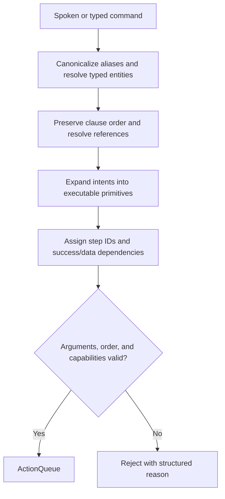

The GPSR command dictionary has three authoritative parts: [language.yaml](config/language.yaml) defines spoken aliases, [scheduler.yaml](config/scheduler.yaml) defines locations and people, and [skill_registry.yaml](../robot_yasmin_tasks/config/skill_registry.yaml) defines executable primitives and lifecycle ownership. Object names, aliases, categories, and search locations come from [object_knowledge.yaml](../robot_yasmin_tasks/config/object_knowledge.yaml). This document explains those existing runtime dictionaries; it does not introduce a second parser vocabulary.



| Words or intent | Canonical meaning / ActionQueue mapping | Required meaning and availability |
| --- | --- | --- |
| go to, navigate to, move to, head to, proceed to | `NAVIGATE` | Known `target_location`; calls persistent navigation interfaces. |
| look for, search for, find, locate + object/category | `FIND_OBJECT` | Object or category, optional location/filters. The skill owns its search navigation. |
| find / locate + named person | `FIND_PERSON` | Known `target_person`; uses lifecycle perception plus persistent identity services. |
| find + person description | `FIND_PERSON_BY_ATTRIBUTE` | Supported selector; uses the existing descriptive-person parser. Shirt colors and positive glasses detection are configured; hat/mask matching requires validated models. |
| how many, count + objects/category | `NAVIGATE` → `COUNT_OBJECTS` | Task location and object/category selector; reporting may append `SAY`. |
| how many, count + people | `NAVIGATE` → `COUNT_PEOPLE` | Task location and supported person/pose filters; reporting may append `SAY`. |
| requested details after attribute search | `EXTRACT_PERSON_INFO` | Requires the search's `person_ref` and `gpsr_guest_memory_id`; this is a planner-generated primitive, not a standalone verb alias. |
| pick up, grasp, grab, pick | `FIND_OBJECT` → `PICK_OBJECT` | Reuses an earlier explicit find where possible. **Blocked: pick implementation missing.** |
| put down, place, put | `FIND_OBJECT` → `PICK_OBJECT` → `PLACE_OBJECT` | Object and destination passed to placement; no separate navigation step is currently inserted. **Blocked: manipulation implementations missing.** |
| bring, deliver, carry to, give to, hand over | `DELIVER_OBJECT` intent expands into acquisition and delivery primitives | Object, recipient and optional locations. **Blocked: manipulation implementations missing.** `DELIVER_OBJECT` itself never enters ActionQueue. |
| follow | `FOLLOW_PERSON` | Person reference; real adapter, but requires `start_follow_person_pipeline:=true` and independently available external drivers. |
| guide, lead | `GUIDE_PERSON` | Person and destination. **Blocked: guide implementation missing.** |
| say, speak, report, tell, greet | `SAY` | Text or a report template and previously produced data. |
| ask, talk to | `ASK_AND_LISTEN` | Question/prompt and any expected answer constraints; uses persistent speech interfaces. |
| take | Context-dependent acquisition, delivery, or guiding intent | “Take the Coke” means acquire; “take the Coke to John” means deliver; “take John to the kitchen” means guide. Corresponding missing skills still block execution. |

Aliases preserve typed meaning: `lounge` → `living_room`, `living room` → `living_room`, `dining room` → `dining_room`, `instruction point` → `instruction_point`; `me` and `instruction person` → person `operator`. Pronouns such as `it` and `him` require an appropriate earlier object/person reference. Unknown or ambiguous references are rejected instead of guessed.

`Greet`, `greet the person`, and `greet everyone` produce a single `SAY` with “Hello! Nice to meet you.” They require no name, age, gender, clothing description, camera, or identity lookup. An explicitly named command such as `greet John` retains the requested recipient search, while keeping the greeting wording neutral. Direct `GreetPersonSkillSM` callers may supply explicit greeting text; otherwise the same default is used.

The existing `gpsr_voice_command` node obtains spoken commands through the `voice` driver's `/voice/stt/start` (`std_msgs/Float32`) and `/voice/stt/transcript` (`std_msgs/String`) topics. Greeting output calls `/voice/tts/say` (`voice_interfaces/srv/SayText`) and returns its success/failure to ActionQueue. A greeting does not wait for a human reply. STT and TTS nodes remain persistent external drivers; the greeting skill does not lifecycle-manage them. Direct skill construction accepts the existing ROS node as `node=...`, or an injected `GreetPersonClient`; missing real TTS clients fail instead of simulating completion.

**Queue ordering contract**

1. Preserve sequential clause order. Match longer aliases first, so “pick up” is treated as one phrase.
2. Expand compound tasks in physical dependency order. A grasp needs a found object; delivery needs successful acquisition before navigation/handover. Reuse explicit earlier object state where the compiler supports it.
3. Give each primitive a unique `step_id`. Planner `dependencies` become ActionStep `requires_success`; `requires_data` names required blackboard/result values, and `result_variable` stores a successful result for later use.
4. Validate that dependencies appear earlier in the queue. The executor does not alphabetically sort or regroup by skill/resource type. Reordering to reduce camera startups could change the command's meaning.
5. Before each dispatch, verify prerequisites; prepare lifecycle resources; execute the skill; receive its structured result; clean resources; then commit success and advance. Failure and retry do not count as completion.
6. Unsupported temporal/concurrent forms, missing slots, and unavailable capabilities remain validation errors. There is no general parallel-task planner.

Examples from the semantic compiler's tested vocabulary:

| Command | Ordered primitive queue / result |
| --- | --- |
| Go to the kitchen and find the Coke. | `NAVIGATE(kitchen)` → `FIND_OBJECT(coke)` |
| Find John and follow him. | `FIND_PERSON(john)` → `FOLLOW_PERSON(john)`; following pipeline must be enabled. |
| Find the Coke and bring it to me. | Find, acquire, deliver to operator; rejected in production while manipulation is missing. |
| Find the red cup. | `FIND_OBJECT(cup)` with a red color filter. |

Inspect a command without starting robot actions using the existing CLI after building and sourcing the workspace:

```bash
# Section: Print canonicalization, entity resolution, primitive order, and validation without execution.
ros2 run gpsr_task_scheduler gpsr_parse_dry_run "Go to the kitchen and find the Coke."
```

**Completion feedback dictionary**

`/execute_action_queue` feedback retains `current_index`, `current_action_type`, and coarse `status`. Its new `status_json` contains the same authoritative snapshot as `/gpsr/action_queue_status_json`:

| Field | Meaning |
| --- | --- |
| `task_id` | Queue identity. |
| `phase` | `QUEUE_STARTED`, `ACTION_SELECTED`, `ACTION_FINISHED`, `ACTION_RETRYING`, or `QUEUE_FINISHED`. |
| `event_index`, `event_step_id` | Step associated with this event; successful completion refers to the step just committed. |
| `current_index`, `completed_count` | Next uncommitted cursor and number of successful committed steps. After successful `ACTION_FINISHED`, these are one greater than `event_index`. |
| `dispatch_outcome` | Actual skill dispatch outcome, such as `success`, `timeout`, or `fatal_failure`. |
| `last_skill_result` | Latest structured result, including `action_type`, `outcome`, `message`, and returned `result` data. |
| `skill_results` | Attempt history, including unsuccessful attempts; its length is not the completed-step count. |
| `items` | Queue entries, IDs, prerequisites, attempt counters, and states. |

Treat `ACTION_FINISHED` plus `dispatch_outcome == "success"` as step completion. `ACTIVE` lifecycle state means ready to accept work; it does not mean a task has completed. Use the terminal ROS action result as the final queue outcome. Rebuild `robot_ai_interfaces` and its consumers together because `status_json` changes the action interface.
