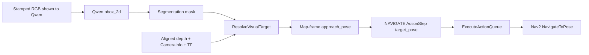

# GPSR Task Scheduler

Section: Deterministic GPSR scheduler front end.

This package parses constrained GPSR commands without an LLM, plans the physical task order, and submits reusable symbolic skills to the existing `robot_yasmin_tasks` executor.

See the [command dictionary](COMMAND_DICTIONARY.md) for spoken aliases, primitive mappings, queue dependency ordering, lifecycle boundaries, and completion feedback.

Section: Canonical language pipeline.

The scheduler retains raw and optional externally normalized text separately. It applies
longest-phrase aliases from `config/language.yaml`, preserves clause order, resolves only
type-safe references, builds a serializable semantic plan, and then adapts that plan to the
existing planner and primitive registry. An upstream LLM may repair grammar and remove filler
words, but it must preserve every entity, attribute, quantity, relationship, and requested
step. It must never emit executor names or directly construct an ActionQueue. Critical-field
drift between raw and normalized text blocks compilation with `LLM_SEMANTIC_DRIFT`.

```text
raw + normalized text -> canonical clauses -> semantic plan
                    -> existing macro planner -> validated ActionQueue
                    -> existing dispatcher and YASMIN skills
```

Section: Build.

```bash
source /opt/ros/humble/setup.bash
colcon build --packages-select robot_ai_interfaces robot_yasmin_tasks gpsr_task_scheduler
```

Section: Dry-run launch.

```bash
source install/setup.bash
ros2 launch gpsr_task_scheduler gpsr_scheduler.launch.py dry_run:=true command_input_mode:=topic
```

Section: Parser/compiler-only dry run.

This command creates no ROS node and dispatches no robot action:

```bash
ros2 run gpsr_task_scheduler gpsr_parse_dry_run \
  "Go to the kitchen, find the Coke, and bring it to John."
```

To inspect an externally normalized command while retaining the raw ASR text:

```bash
ros2 run gpsr_task_scheduler gpsr_parse_dry_run \
  "could you uh go kitchen and find coke" \
  --normalized "Go to the kitchen and find the Coke."
```

Section: Full-system launch.

```bash
source install/setup.bash
ros2 launch gpsr_task_scheduler gpsr_scheduler.launch.py dry_run:=false command_input_mode:=topic
```

Section: Runtime ownership.

`gpsr_scheduler.launch.py` owns exactly one `voice_tts` and one `voice_stt` process by default.
Do not additionally start `voice.launch.py`, `gpsr_executor.launch.py`, or another task voice
launch with its voice switches enabled. If an external voice launch is intentionally the owner,
use `start_voice_tts:=false start_voice_stt:=false` on the scheduler.

The scheduler does not start a base driver. Start exactly one navigation/base bringup separately
(for example `gpsr_base_driver.launch.py` or `drivers_bringup.launch.py`), never both. A duplicate
TTS, STT, or base-driver process now exits before it advertises ROS endpoints or opens the audio
or Arduino hardware.

Section: Full GPSR scheduler, executor, and CV perception launch.

```bash
source install/setup.bash
ros2 launch gpsr_task_scheduler gpsr_scheduler.launch.py \
  dry_run:=false \
  start_executor:=true \
  start_find_object_pipeline:=true \
  start_count_objects_pipeline:=true \
  start_count_people_pipeline:=true \
  start_find_person_pipeline:=true \
  start_find_person_attribute_pipeline:=true
```

This starts the scheduler, the central GPSR lifecycle manager, `/execute_action_queue`,
`/gpsr/find_object`, `/gpsr/count_people`, `/gpsr/count_objects`, their perception services,
and the transient person/object/pose detector nodes. The transient nodes start
`UNCONFIGURED`; the manager activates only the selected state-machine resource group and
returns it to `UNCONFIGURED` before the queue advances.

Set `enable_depth:=false` when only an RGB camera is available. In that mode FIND_OBJECT
still performs named-waypoint navigation, scanning, and stable visual verification, but it
does not wait for aligned depth or CameraInfo, does not publish a localized object map pose,
and skips the final stand-off approach. The action result reports `approached=false`.

`lifecycle_transition_timeout_sec` defaults to 60 seconds and bounds the entire manager
operation rather than each individual transition. `lifecycle_operation_timeout_margin_sec`
adds a 10-second executor response margin. A timed-out prepare is followed by explicit
cleanup, preventing a late service completion from leaving an unowned ACTIVE group.

Section: Runtime state-machine selection.

```text
/gpsr/command
      |
      v
scheduler parser and planner
      |
      v
ActionStep.action_type
      |
      v
executor dispatcher -> matching SkillSM
      |
      v
lifecycle manager -> configure -> activate -> execute -> deactivate -> cleanup
```

Every pipeline switch defaults to `true`, so the single scheduler launch can accept any
implemented perception command without a restart. `FIND_OBJECT` and `COUNT_OBJECTS` have
independent switches but share one `/gpsr_object_detection_node`; the detector process starts
when either pipeline is enabled. Lifecycle activation still occurs only for the state machine
selected by the executor.

Section: Initial spoken command reception.

The full scheduler launch starts one persistent `gpsr_voice_command` listener. Each logical STT
window lasts `12.0` seconds by default. A timeout leaves the robot stationary and the existing
timer re-arms the same listener; it does not recreate `/gpsr/command` subscriptions or submit a
navigation goal. Configure the window with `command_input_timeout_sec:=12.0`.

Section: Fuzzy object-name clarification.

Object targets are first matched against the authoritative RoboCup object aliases and
categories. If no exact match exists, the scheduler may offer one high-confidence fuzzy
suggestion, for example `I could not match "aplle" to a configured object. Did you mean
"apple"? Reply "yes" to confirm, or provide another object.` The command remains blocked
until the operator confirms the suggestion or supplies another configured object. Weak or
ambiguous matches receive the ordinary `Which object or person do you mean?` clarification;
the planner never silently autocorrects an object name. The structured clarification payload
contains `suggestion.input`, `suggestion.suggested_target`, and `suggestion.score` for UI clients.

Section: Per-command return policy.

The default scheduler freezes the newest valid `map`-frame `/amcl_pose` when a command is
accepted. The pose is normalized and remains unchanged until that command finishes. If no
fresh valid pose arrives within three seconds, command reception remains valid and the scheduler
stores the named `instruction_point` only as metadata for its later return policy.

For an exhaustive `FIND_OBJECT` `NOT_FOUND` result, the scheduler first returns to this
frozen command-start pose and then reports `I could not find the <target>.` through the
normal `SAY` skill. This report is automatic even when the original instruction did not
explicitly request speech. If return navigation fails, speech remains pending until guarded
return recovery succeeds.

`FIND_OBJECT` owns one deterministic semantic retry in the compound search policy. With
`max_not_found_retries: 1`, a complete route is searched once more only when the first
complete route returns `NOT_FOUND`; the mission keeps one shared timeout deadline. A final
miss in a compound acquisition or delivery command is reported after the scheduler confirms
return to the frozen command-start pose.

```text
WAITING_FOR_COMMAND
        |
        v
CAPTURING_RETURN_POSE -- no valid AMCL pose in 3 s --> store later-return fallback
        |
        v
PLANNING -> EXECUTING -> RETURNING_TO_COMMAND_START
                              | success
                              v
                      REPORTING_RESULT (when requested)
                              |
                              v
                   WAITING_FOR_COMMAND / FINISHED
```

Raw captured poses use Nav2 `/navigate_to_pose`; ordinary semantic locations and the later-return
fallback use `/nav/navigate_named_pose`. Startup navigation is disabled by default. Explicitly set
`return_target_mode:=named_location` for the prior named-only policy, or set
`navigate_to_instruction_point_on_start:=true` to restore startup motion. Dry-run mode does
not wait for AMCL and publishes only the configured return policy.

Section: Primitive-only ActionQueue vocabulary.

Natural-language verbs are parser aliases and never enter `ActionStep.action_type`. The
planner emits only the canonical primitives declared as constants in
`robot_ai_interfaces/msg/ActionStep` and registered in
`robot_yasmin_tasks/config/skill_registry.yaml`. Compound commands such as `take`, `place`,
and `bring` are expanded into ordered primitives by the planner. A place command always
produces `FIND_OBJECT -> PICK_OBJECT -> PLACE_OBJECT`, with explicit success and result-data
dependencies between the steps. If any required primitive is not a real production-enabled
capability, the plan is retained for diagnostics but rejected with `primitive_unavailable`
before queue submission.

Temporary queue aliases (`PICK`, `PLACE`, `GIVE`, `FOLLOW`, `GUIDE`, `ASK`, `REPORT`,
`GREET`, and `RETURN_TO_INSTRUCTION_POINT`) are normalized at executor admission and emit a
deprecation warning. Newly generated scheduler queues use only explicit primitive names.

Name and attribute person searches use separate symbolic actions and lifecycle groups:

```text
selector.type=name
      |
      v
FIND_PERSON -> FIND_PERSON_SKILL_SM

selector.type=pose|gesture|any_person
      |
      v
FIND_PERSON_BY_ATTRIBUTE -> FIND_PERSON_BY_ATTRIBUTE_SM
```

Both person routes are compound search skills. An explicit task location sets
`search_scope=STRICT_LOCATION`; a location-free command sets `search_scope=GLOBAL` and the
executor loops through `find_person_search.yaml`. The planner therefore does not prepend a
separate `NAVIGATE` step to either person-finding action.

`FIND_OBJECT` uses the same compound-skill boundary: the executor navigates through
`find_object_search.yaml` before each local observation, while an explicit task location
produces one strict-location navigation leg. The planner therefore keeps navigation inside
the single `FIND_OBJECT` action instead of adding a duplicate `NAVIGATE` step.

`start_find_person_pipeline` controls face identity and verbal confirmation.
`start_find_person_attribute_pipeline` independently controls the shared human detector,
MediaPipe pose detector, and real `/perception/human_poses` attribute evidence. A disabled
route fails lifecycle preparation with `skill_unavailable`; it never uses simulated success.

Section: Required dependent nodes for full execution.

Navigation action servers and any persistent manipulation, identity, or voice dependencies
must be running before non-dry-run execution. The scheduler launch owns the executor,
lifecycle manager, and transient GPSR perception/action servers by default.

Section: Error recovery.

Every execution failure retains its broad queue `outcome` and carries a stable
`failure_code` plus `failure_phase` in `SkillResult.result_json`. Recovery and user
reporting must use these fields rather than parse the human-readable message.

| Failure code | Broad outcome | Executor behavior |
| --- | --- | --- |
| `TARGET_OBJECT_NOT_FOUND` | `not_found` | Complete the bounded search policy, skip dependent manipulation, return, and report the miss. |
| `OBJECT_ATTRIBUTE_MISMATCH` | `not_found` | Preserve visible candidate evidence, skip dependent manipulation, return, and report the mismatch. |
| `PERSON_ATTRIBUTE_MISMATCH` | `not_found` | Preserve requested predicates and visible-person evidence, then report the mismatch. |
| `PERCEPTION_UNAVAILABLE` | `recoverable_failure` or `failed` | Recover/retry within policy; never describe unavailable observations as a semantic miss. |
| `INVALID_INPUT` | `invalid_input` | Reject before further robot actions and terminate the invalid queue. |
| `LIFECYCLE_SKILL_UNAVAILABLE` / `SKILL_UNAVAILABLE` | `skill_unavailable` | Abort the queue because the required execution resource is unavailable. |
| `MANIPULATION_FAILED` / `MANIPULATION_GOAL_REJECTED` / `MANIPULATION_TIMEOUT` | `failed` or `timeout` | Preserve held-object state, skip dependent actions, and report the operation-specific failure. |

Object and person action servers transport their detailed terminal evidence through
`failure_json`; the executor adapter merges it into `SkillResult.result_json`. Successful
results leave `failure_json` empty.

When an initial or post-command return to the Instruction Point fails, the scheduler enters
`ERROR`, waits for the configured delay, and transitions through
`RECOVERING_TO_INSTRUCTION_POINT`. Command admission remains closed until a recovery return
succeeds. Success restores `WAITING_FOR_COMMAND`; failure returns to `ERROR` for another
bounded attempt. Configure this behavior with `enable_error_recovery`,
`error_recovery_max_attempts`, and `error_recovery_retry_delay_sec`. A maximum of zero retries
indefinitely. `executor_goal_response_timeout_sec` controls the executor acknowledgement wait
and defaults to 30 seconds. Dry-run startup always skips physical initial navigation.

Reset an exhausted or unwanted `ERROR` state back to command intake:

```bash
ros2 service call /gpsr/reset_state std_srvs/srv/Trigger "{}"
```

The service accepts only while the scheduler is `ERROR`. It clears stale command ownership
and changes the cycle directly to `WAITING_FOR_COMMAND`; it does not command recovery motion.

Section: YASMIN scheduler-cycle viewer.

```text
INITIALIZING -> GO_TO_INSTRUCTION_POINT -> WAITING_FOR_COMMAND
                                           |
                                           v
                                     PLANNING -> EXECUTING
                                           |          |
                                           |          v
                                           +----> RETURNING_TO_INSTRUCTION_POINT
                                                        | failure
                                                        v
                                                      ERROR
                                                        | /gpsr/reset_state
                                                        v
                                               WAITING_FOR_COMMAND
```

`gpsr_scheduler.launch.py` publishes this supervisory machine as
`GPSR_SCHEDULER_CYCLE` on `/fsm_viewer` by default. Start the web viewer with:

```bash
ros2 run yasmin_viewer yasmin_viewer_node
```

Open `http://localhost:5000`, then select `GPSR_SCHEDULER_CYCLE`. Set
`enable_scheduler_viewer:=false` only when visualization is not wanted.

Section: Dry-run command example.

```bash
ros2 topic pub --once /gpsr/command std_msgs/msg/String "{data: 'count people in the kitchen go to the living room tell me'}"
```

Section: Dry-run service command example.

```bash
ros2 service call /gpsr/schedule_command robot_ai_interfaces/srv/ScheduleCommand "{command_id: 'test_001', instruction: 'count people in the kitchen go to the living room tell me', dry_run: true, execute: false, overall_timeout_sec: 60.0}"
```

Section: Execution service command example.

```bash
ros2 service call /gpsr/schedule_command robot_ai_interfaces/srv/ScheduleCommand "{command_id: 'gpsr_001', instruction: 'count people in the kitchen go to the living room tell me', dry_run: false, execute: true, overall_timeout_sec: 300.0}"
```

Expected dry-run plan:

```text
NAVIGATE(target_location=kitchen)
COUNT_PEOPLE(target_location=kitchen)
NAVIGATE(target_location=living_room)
SAY(text='I counted {result.count} people.')
```

Section: Exhaustive and random scheduler-plan validation.

The validator checks every phrase ordering of the supported task templates and then
checks additional seeded random orderings. For each accepted command it verifies the
task family, physical skill order, semantic dependency edges, positive execution
policy, and lossless conversion to an executor-compatible `ActionStep` dictionary.
It does not command robot hardware.

```bash
source install/setup.bash
gpsr_validate_sequences --seed 20260805 --random-cases 1000
```

The default run covers 96 exhaustive permutations (four supported task families ×
24 phrase orders) plus the requested random cases. A nonzero exit status and JSON
failure list identify any command whose plan is not executable by the action queue.

Section: Recipient command example.

```bash
ros2 topic pub --once /gpsr/command std_msgs/msg/String "{data: 'count people in the kitchen go to the living room tell john'}"
```

Expected dry-run plan:

```text
NAVIGATE(target_location=kitchen)
COUNT_PEOPLE(target_location=kitchen)
NAVIGATE(target_location=living_room)
FIND_PERSON(target_person=john, target_location=living_room)
SAY(text='I counted {result.count} people.')
```

Section: Launch parameters.

The scheduler launch additionally exposes `return_target_mode`, `amcl_pose_topic`,
`amcl_pose_max_age_sec`, `amcl_pose_capture_timeout_sec`,
`return_fallback_named_location`, `navigate_to_pose_action`,
`navigate_to_named_pose_action`, and `navigate_to_instruction_point_on_start`. See
`gpsr_scheduler.launch.py --show-args` for the complete perception, voice, executor, and
recovery parameter list.

## Qwen segmented-ROI navigation

Section: Safety boundary and data flow.

Qwen supplies only a semantic target and a two-dimensional image region. The vision
resolver correlates that region with aligned depth, calibrated `CameraInfo`, and TF;
it returns an observed entity pose plus a planar stand-off pose in `map`. The bridge
then publishes a canonical single-step `ActionQueue`. Automatic submission to
`/execute_action_queue` is disabled by default.



Section: Build and launch without motion.

```bash
colcon build --packages-select robot_ai_interfaces vision gpsr_task_scheduler
source install/setup.bash
ros2 launch gpsr_task_scheduler qwen_visual_navigation.launch.py auto_execute:=false
```

For a bbox-only topic-contract test before the segmenter is connected, add
`default_require_mask:=false`. Keep the production default `true` for navigation.

The Qwen ROS wrapper must copy the source RGB header stamp into the envelope; the
model must not generate this timestamp. It publishes the envelope on
`/ai/qwen/grounding_json` and a `mono8` selected-instance mask with the same stamp on
`/ai/qwen/selected_mask`:

```json
{
  "request_id": "visual_nav_001",
  "image_stamp": {"sec": 1726800000, "nanosec": 120000000},
  "stand_off_distance": 0.9,
  "require_mask": true,
  "selected_entity": {
    "target_id": "red_cup_7",
    "label": "red cup",
    "bbox_2d": [214, 305, 466, 822],
    "coordinate_width": 1000,
    "coordinate_height": 1000
  }
}
```

The resolver publishes inspectable poses on `/vision/qwen_target_pose` and
`/vision/qwen_approach_pose`. The bridge publishes the resulting typed queue on
`/gpsr/visual_navigation_queue` and decisions on
`/gpsr/visual_navigation_status`. After RViz and costmap inspection, enable executor
submission explicitly:

```bash
ros2 launch gpsr_task_scheduler qwen_visual_navigation.launch.py auto_execute:=true
```

Section: ActionQueue pose contract.

The bridge writes the resolver-owned stand-off pose into `parameters_json`; it leaves
`target_location` empty so `Nav2Client` selects its existing raw-pose route:

```json
{
  "action_type": "NAVIGATE",
  "target_location": "",
  "parameters": {
    "target_pose": {
      "frame_id": "map",
      "position": {"x": 1.2, "y": -0.4, "z": 0.0},
      "orientation": {"x": 0.0, "y": 0.0, "z": 0.38, "w": 0.92}
    },
    "target_reference": "red_cup_7",
    "target_source": "QWEN_SEGMENTED_ROI_DEPTH"
  }
}
```

Do not insert the entity's measured 3D point as the Nav2 goal: it normally lies on
the person, object, table, or obstacle. Only the collision-checkable stand-off pose
is passed to `NAVIGATE`. Nav2 remains responsible for path feasibility and rejects
an occupied or unreachable goal.
