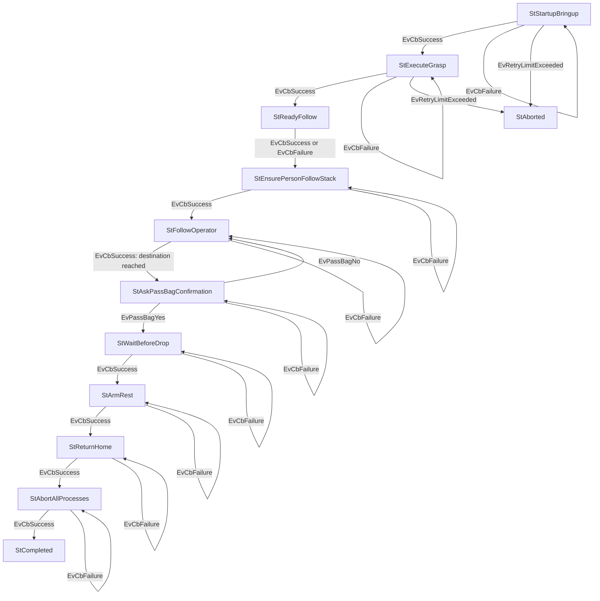

# Carry My Luggage Combined Phase Workflow

This document describes the runtime workflow of the `carry_my_luggage_phase1` SMACC2 state machine after combining the original phase-1 grasp flow with the post-arrival carry-my-luggage flow.

## 1) High-Level Flow

The state machine now performs one continuous task:

1. Launch and validate the carry-my-luggage bringup.
2. Execute the grasp.
3. Run the ready-follow voice prompt.
4. Ensure the person-follow stack is running.
5. Start a person-follow session.
6. Detect destination reach from the follow action result (`stopped: behavior_aborted`).
7. Ask whether to pass the bag.
8. If the operator says no, resume following.
9. If the operator says yes, wait 5 seconds, open the gripper, return home, stop all running processes, and finish.

If retry limits are exceeded during bringup or grasp execution, the state machine transitions to `StAborted` and stops.

## 2) State Machine Block Diagram

## 3) State-by-State Behavior

### `StStartupBringup`
- Client behavior: `CbStartFullSystemBringup`
- Launches/reuses `carry_my_luggage_bringup.launch.py`
- Waits for controller manager and `/grasp/is_ready`
- Success -> `StExecuteGrasp`
- Failure -> retry
- Retry overflow -> `StAborted`

### `StExecuteGrasp`
- Client behavior: `CbExecuteGrasp`
- Calls `/grasp/execute`
- Success -> `StReadyFollow`
- Failure -> retry
- Retry overflow -> `StAborted`

### `StReadyFollow`
- Client behavior: `CbReadyFollow`
- Calls `/person_follow/announce_ready`
- Success or failure -> `StEnsurePersonFollowStack`

### `StEnsurePersonFollowStack`
- Client behavior: `CbStartPersonFollowStackManaged`
- Calls `/bringup/person_follow`
- Ensures `person_follow_nav2.launch.py` is active
- Success -> `StFollowOperator`
- Failure -> retry

### `StFollowOperator`
- Client behavior: `CbStartPersonFollowSession`
- Calls `/person_follow/control`
- Destination is considered reached when the action result message contains `behavior_aborted`
- Success -> `StAskPassBagConfirmation`
- Failure -> retry

### `StAskPassBagConfirmation`
- Client behavior: `CbAskPassBagDialog`
- Calls `/receptionist`
- `handover_ok=true` -> `EvPassBagYes`
- `handover_ok=false` -> `EvPassBagNo`
- Yes -> `StWaitBeforeDrop`
- No -> `StFollowOperator`
- Dialogue failure -> retry

### `StWaitBeforeDrop`
- Client behavior: `CbWait5Seconds`
- Waits 5 seconds
- Success -> `StArmRest`
- Failure -> retry

### `StArmRest`
- Client behavior: `CbArmRest`
- Calls `/grasp/rest`
- Success -> `StReturnHome`
- Failure -> retry

### `StReturnHome`
- Client behavior: `CbReturnHomeManaged`
- Calls `/return_home/control`
- Success -> `StAbortAllProcesses`
- Failure -> retry

### `StAbortAllProcesses`
- Client behavior: `CbAbortAllProcesses`
- Stops the tracked carry-my-luggage bringup process group using the shared shutdown utility
- Success -> `StCompleted`
- Failure -> retry

### `StCompleted`
- Logs the combined task completion.

### `StAborted`
- Entered when retry limit is exceeded during startup or grasp.
- Stops heavy bringup nodes and terminates the SM.

## 4) Runtime Notes

- `/bringup/person_follow` launches the stack, but the actual follow session is started separately through `/person_follow/control`.
- The state machine does not rely on `/person_follow/ended`.
- Arrival uses the current person-follow behavior already present in the workspace:
  - `enable_face_abort=true`
  - `face_hold_sec=5.0`
  - follow ends with `behavior_aborted` when the operator faces the robot long enough.
