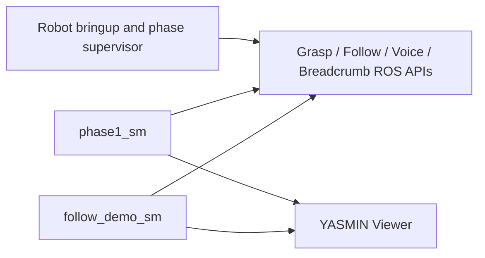

# Carry My Luggage — YASMIN ports

This ROS 2 package contains two executable YASMIN state machines derived from the active transition headers in the workspace:

- `phase1_sm`: button-triggered bag selection, grasp, operator following, voice confirmation, bag release, breadcrumb return, and cleanup.
- `follow_demo_sm`: grasp, unmapped person following to the destination, timed bag release, return-home session, and cleanup.

## Runtime topology



The launch files intentionally do not start hardware or navigation bringup. Start the appropriate robot stack once, then start exactly one state machine.

## Build

```bash
source /opt/ros/humble/setup.bash
colcon build --packages-select carry_my_luggage_yasmin
source install/setup.bash
```

## Run

```bash
ros2 launch carry_my_luggage_yasmin phase1_yasmin.launch.py
```

or:

```bash
ros2 launch carry_my_luggage_yasmin follow_demo_yasmin.launch.py
```

For live visualization, run `ros2 run yasmin_viewer yasmin_viewer_node` in another terminal.

## Required ROS contracts

The full phase-one graph uses `/grasp/is_ready`, `/dio13_state`, breadcrumb teach/repeat services, `/bringup/bag_point_selection`, `/bag_ready_for_pickup`, grasp services, `/bringup/person_follow`, `/master_target`, `/receptionist`, and `/kill`.

The follow demo uses `/grasp/is_ready`, grasp services, `/person_follow/mode`, `/person_follow/control`, `/return_home/start`, and the cleanup endpoints.

The ports use bounded per-state retry counters. Optional cleanup calls are best effort so an already-stopped subsystem cannot deadlock machine termination.
